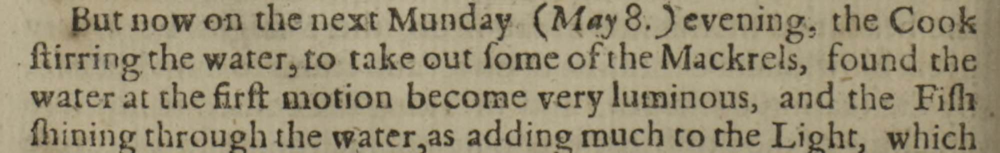
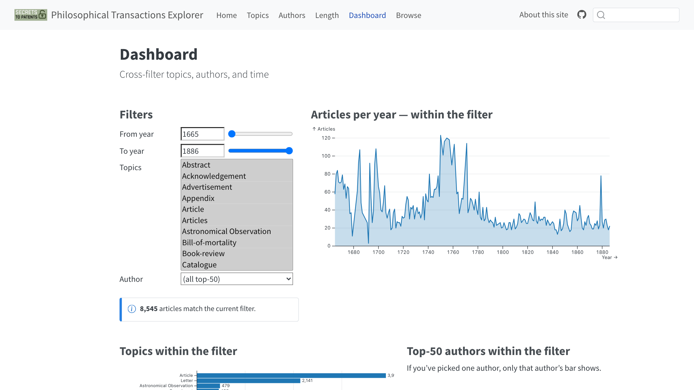
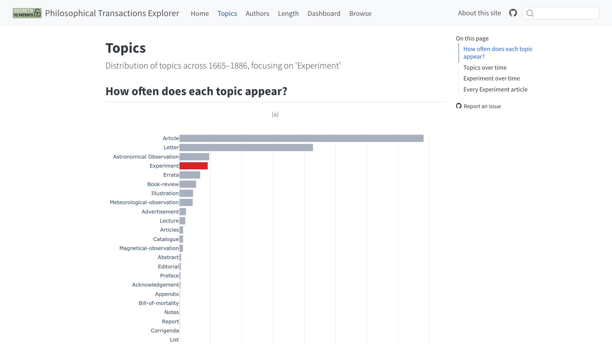

```{python}
#| label: setup
import json
from pathlib import Path

import pandas as pd
import plotly.graph_objects as go

SAGE, GREEN, INK, MUTED, HAIRLINE = "#a5b097", "#5b7f3a", "#2b3324", "#5f6856", "#dcdfd4"

articles = pd.DataFrame(json.loads(Path("data/articles.json").read_text()))
articles["decade"] = articles.year // 10 * 10
articles["is_letter"] = articles.topic.eq("Letter")
articles["no_author"] = articles.authors.map(len).eq(0)
by_decade = articles.groupby("decade").agg(
    letter_share=("is_letter", lambda s: 100 * s.mean()),
    median_pages=("n_pages", "median"),
    no_author=("no_author", lambda s: 100 * s.mean()),
)


def decade_bars(series, highlight, unit, name):
    """One-series decade bars: emphasised decades get a colour and a direct label."""
    labels = [f"{series[d]:.0f}{unit}" if d in highlight else "" for d in series.index]
    fig = go.Figure(go.Bar(
        x=series.index,
        y=series.values,
        text=labels,
        textposition="outside",
        textfont=dict(size=24, color=INK),
        cliponaxis=False,
        marker_color=[GREEN if d in highlight else SAGE for d in series.index],
        hovertemplate="%{x}s: %{y:.1f}" + unit + "<extra>" + name + "</extra>",
    ))
    fig.update_layout(
        width=1190, height=490, bargap=0.18, barcornerradius=4, showlegend=False,
        margin=dict(l=70, r=20, t=44, b=48),
        paper_bgcolor="rgba(0,0,0,0)", plot_bgcolor="rgba(0,0,0,0)",
        font=dict(family="Helvetica Neue, Helvetica, Arial, sans-serif", size=20, color=MUTED),
        hoverlabel=dict(font_size=20),
    )
    fig.update_xaxes(tickvals=list(range(1660, 1890, 40)), ticktext=[f"{d}s" for d in range(1660, 1890, 40)],
                     showgrid=False, linecolor=HAIRLINE, ticks="")
    fig.update_yaxes(gridcolor=HAIRLINE, zeroline=False, ticksuffix=unit, rangemode="tozero", nticks=5)
    fig.show(config={"displayModeBar": False})
```

## {.title-slide-custom}

{.title-logo .nostretch}

<h1 style="font-size:1.9em; line-height:1.1; text-align:left; margin-bottom:0.3em;">Reading 220 years of science by machine</h1>

<p style="font-size:1.05em; margin-bottom:1.4em;">The Philosophical Transactions Explorer, and how far to trust it</p>

<p class="title-kicker">Mathias Johansson · Secrets to Patents<br>DEPTH, Lund University · 13 November 2026</p>

::: {.notes}
[0:20] Thank you. I'm going to talk about a tool we built for reading one very old scientific journal at scale. I'll show what it lets us see, how it was made, and then spend the end of the talk on the part that interests DEPTH most: what happens when the machine reading the sources gets it wrong, and why the way it gets it wrong matters for the history we want to write.
:::

## Monday evening, 8 May 1665

{.scan .nostretch}

::: {.quote .fragment}
"…the Cook stirring the water, to take out some of the Mackrels, found the water at the first motion become very luminous, and the Fish shining through the water…"
:::

<p class="caption-line">Dr Beale's report, <em>Philosophical Transactions</em>, vol. 1, p. 226. Scan: Royal Society.</p>

::: {.notes}
[0:45] Let me start with a cook in 1665. The cook goes to fetch some pickled mackerel, stirs the water, and the water lights up. The fish are glowing through it. The report gives the dates of each batch of pickle, and it's communicated by a Dr Beale and printed in the Philosophical Transactions under the heading "An Experiment". So here, in the first year of the journal, something noticed by a cook is printed as experimental knowledge. Keep that cook in mind, because the question of where experiments happened, and who was in the room, is where this talk ends up. Now look at the type. This is the page as we have it, and it's what we asked a machine to read.
:::

## What the machine read

<table class="compare">
<thead><tr><th>Printed on the page</th><th>The model we chose</th><th>Another model we tried</th></tr></thead>
<tbody>
<tr><td>Celerity of Motion</td><td><span class="wrong">Celebrity</span> of Motion</td><td>Celerity of Motion</td></tr>
<tr><td>the Fish shining</td><td>the Fish shining</td><td>the <span class="wrong">Fifth flinching</span></td></tr>
</tbody>
</table>

::: {.fragment}
<p style="margin-top:1.1em;">In 1665 "Fish shining" is printed with a long&nbsp;s: <em>Fiſh ſhining</em>.</p>
<p>Each error is plausible. Each reads as fluent English. <strong>That is the problem.</strong></p>
:::

<p class="caption-line">From a trial of eight small vision models on this page. The trial notes rank a larger model first. We chose a smaller, faster one for 8,506 pages.</p>

::: {.notes}
[1:00] We tried eight small AI vision models on this one page. The one we ended up using read the title as "what Figure and Celebrity of Motion begetteth". Another model correctly got celerity, but then told us about "the Fifth flinching through the water". If you look back at the scan you can see why: the old long s looks a lot like an f, so "fish shining" looks like "fifh fhining". These are lovely errors, and I'll admit they're fun to collect. But notice what kind of errors they are. They aren't garbled. Older OCR gave you visible noise, strings of odd characters that you could spot at a glance. These models give you fluent, confident English that happens to be wrong. A reader skimming the output wouldn't stop. So that's my question for the next twenty minutes: what can a 220-year-old journal tell us, and how far can we trust the machine that is reading it?
:::

## The journal

- *Philosophical Transactions* began in 1665. It is the longest-running scientific journal in the world.
- Not a journal as we know it: letters, observations, experiments, book reviews, adverts.
- A record of who could speak about nature, from where, and in what form.

::: {.notes}
[0:50] A quick word on the source for those who don't live with it. The Philosophical Transactions started in 1665 and it's still going, which makes it the longest-running scientific journal in the world. But when you open the early volumes it doesn't look like a journal in the modern sense. There are letters from correspondents, tables of astronomical observations, reports of experiments, reviews of books, even advertisements. It's closer to a clearing house for news about nature. That's what makes it useful for historians. It isn't only a record of what people found. It records who was able to speak about nature, where they were writing from, and in what form they were expected to say it.
:::

## Why we care: Secrets to Patents

<p class="quote" style="font-size:1.1em;">Trans-Imperial Strategies for Keeping Medicines as Private Assets from 1500 to 1900</p>

- How knowledge moved between **secret** and **shared**
- So the journal raises a specific question: **where did experimental knowledge get made, and how public was that place?**

<p class="caption-line">Principal investigator: Natacha Klein Käfer. <a href="https://secretstopatents.org/">secretstopatents.org</a></p>

::: {.notes}
[0:50] This work sits inside Secrets to Patents, a project led by Natacha Klein Käfer. The full title is Trans-Imperial Strategies for Keeping Medicines as Private Assets from 1500 to 1900. So private is a word that carries a lot of weight in this project. That gives us a specific question to ask of this journal. When someone reports an experiment, where did it take place? In a private house, a shared institution, on a ship? And how much of that setting can we recover from thousands of pages? That is too much to read closely by hand, which is why we wanted a machine to help. Hold on to that word, private. It'll come back.
:::

## The material

::: {.stats}
::: {.stat}
<span class="n">8,545</span><span class="l">items in the catalogue</span>
:::
::: {.stat}
<span class="n">222</span><span class="l">years, 1665 to 1886</span>
:::
::: {.stat}
<span class="n">455</span><span class="l">labelled "Experiment" (about 5%)</span>
:::
:::

Two levels of evidence:

- **Metadata for everything:** title, year, authors, label, pages
- **Full text only for the 455 Experiment articles,** read by machine

::: {.notes}
[0:40] Here's the scale. We have 8,545 items, covering 222 years up to 1886. Of those, 455 carry the label "Experiment", about five percent. It's important to hold apart two levels of evidence, because I'll move between them. For all 8,545 items we have metadata: the title, year, authors, a label, and the page numbers. For only those 455 Experiment articles do we also have the full text, as read by a machine. So when I show you a trend across two centuries, that's metadata and it isn't reading anything inside the articles. When I talk about locations, that's machine reading, and only on that five percent.
:::

## The Philosophical Transactions Explorer

{.shot .nostretch}

<p class="caption-line">Five views: topics, authors, article length, a filtering dashboard, a searchable list of all 8,545 items. Metadata only.</p>

::: {.notes}
[0:40] The Explorer is a public website that makes the metadata browsable. It has five views: labels over time, authors, article length, a dashboard where you can filter by years, labels and authors together, and a browse table of every item with a link back to the publisher. It's deliberately simple, and it's worth saying what it isn't. There's no AI in this site, no reading of the text. It's a catalogue that you can look at from different angles. And the reason I think that's valuable is that even this plain metadata shows the journal changing shape, in ways you wouldn't notice reading one volume at a time. Let me show you three of them.
:::

## The letter rises, then disappears

```{python}
decade_bars(by_decade.letter_share.round(1), {1660, 1750, 1870}, "%", "Share labelled Letter")
```

<p class="caption-line">Share of items labelled "Letter", by decade. 1660s covers 1665–69, 1880s covers 1880–86. Titles mentioning a letter show the same collapse.</p>

::: {.notes}
[1:15] First, the letter. This shows the share of each decade's items that carry the label "Letter". In the 1660s it's about one in six. By the 1750s it's half of the journal. Half of what's printed is presented as a letter from someone to someone. Then it collapses, and by the 1850s it is under one percent. The last one in the catalogue is from 1860. Now, as I'll come to, these labels come from the publisher's website, so you should ask whether letters really vanished or whether someone just stopped labelling them. So we checked the titles too. Titles containing the word "letter" fall away in just the same way. What the data can't tell us is whether people stopped writing to the Society. What it shows is that they stopped presenting their work in that form. Scientific knowledge stops arriving as correspondence and starts arriving as a paper.
:::

## The typical article grows from 3 pages to over 20

```{python}
decade_bars(by_decade.median_pages, {1660, 1870, 1880}, "", "Median pages")
```

<p class="caption-line">Median pages per item, by decade, for the 8,081 items with usable page numbers. 1880s covers 1880–86.</p>

::: {.notes}
[1:15] Second, length. This is the median, the middle article in each decade. In the 1660s the typical item is three pages. It stays around four pages for about a century. Then from the 1770s it starts climbing, and by the 1870s the typical article is twenty pages, with thirty-two in the short final stretch of the 1880s. I'm using the median on purpose. If you sort this catalogue by length, the longest article is a reply by Newton from 1672 at over a thousand pages, which is simply a typing error in the page numbers. A median doesn't care about that. So what does the rise mean? Combined with the letter, you can see a form being invented: the long, self-contained research paper, with its methods and its tables, replacing the short dispatch.
:::

## Fewer and fewer items without a named author

```{python}
decade_bars(by_decade.no_author.round(1), {1660, 1870}, "%", "No author listed")
```

<p class="caption-line">Share of items with no author listed in the publisher's metadata, by decade. 1660s covers 1665–69.</p>

::: {.notes}
[1:15] Third, authorship. Here's the share of items with no author listed. In the 1660s it's over half. By the 1870s it's two percent. I'm being careful with the wording: this is "no author listed in the metadata", which isn't the same as anonymous. Some of those early items do name someone in the title, "communicated by Mr so-and-so", and the metadata simply doesn't record that person as an author. So part of this curve is the history of cataloguing. But part of it is real: over two centuries the journal becomes a place where a contribution is attached to a named individual, and you can see credit becoming the organising principle. Letter to paper, short to long, unattributed to named. Three shifts, and none of them needed anyone to read an article.
:::

## See for yourself

{.shot .nostretch}

<p class="caption-line"><a href="https://digitalhistory-lund.github.io/SecToPat-PhilTransExplorer/">digitalhistory-lund.github.io/SecToPat-PhilTransExplorer</a></p>

::: {.notes}
[0:45] Let me show you the live site very briefly. [Open the link. If the network fails, stay on this slide, it's the same page.] This is the topics view. Experiment is in red, and you can see how small it is next to articles and letters. On the dashboard you can narrow down to a range of years and a label, and the browse table takes you to any individual item at the publisher. I'd encourage you to try it after the talk. And watch for one thing on this list: "Article" and "Articles" appear as two separate labels. Hold that thought. [Return to the slides.]
:::

## How the catalogue was made

<p class="flow-label">Every item: no AI involved</p>
<div class="flow">
<div class="step"><b>Crawl</b>publisher's public pages, decade by decade</div><div class="arrow">→</div>
<div class="step"><b>Index</b>one database of articles and authors</div><div class="arrow">→</div>
<div class="step"><b>Aggregate</b>counts checked to reconcile</div><div class="arrow">→</div>
<div class="step"><b>Publish</b>a static website</div>
</div>

<p style="margin-top:1em;">8,545 records and 8,545 PDFs. The script stops if the totals don't add up.</p>

::: {.notes}
[0:50] So how was it made? I'll keep this plain. There are two routes. The first is for the catalogue, and it has no AI in it at all. A program walks through the publisher's public pages, decade by decade and issue by issue, and collects the information about each article and its PDF. That goes into one database. Then a script produces the summary tables, and it refuses to continue if the totals don't reconcile, so if the numbers on the website don't add up the site doesn't get built. The result is a static website, which means there's nothing to maintain and nothing to break. This part is ordinary, careful data work, and everything on the charts you just saw came out of this route.
:::

## How the full text was read

<p class="flow-label">The 455 Experiment articles: small AI models, run locally</p>
<div class="flow">
<div class="step"><b>Scan to image</b>each page as a picture</div><div class="arrow">→</div>
<div class="step ai"><b>Read the page</b>vision model turns image into text</div><div class="arrow">→</div>
<div class="step"><b>Cut out the article</b>using its title</div><div class="arrow">→</div>
<div class="step ai"><b>Extract</b>was it an experiment? where? who?</div>
</div>

<p style="margin-top:1em;">8,506 pages of text. <strong>Pink steps are where errors of judgement get in.</strong></p>

::: {.notes}
[0:50] The second route is for reading the text, and only for the 455 Experiment articles. Each page becomes an image. A small vision model turns the image into text. That's the step that gave us the celebrity and the flinching fish. Then we cut out the article from the surrounding pages, and a language model answers three questions about it: is this an experiment, where did it take place, and who took part? In total that's about 8,500 pages. The pink boxes are the two steps where a model makes a judgement. Everything else is mechanical. Notice that the place where the model answers "where" is a step that takes a free reading of an old text and turns it into a neat data field. Once it's in that field, it looks like a fact.
:::

## What a small team can now do

- Models small enough to run **on our own machine**, with no sources sent elsewhere
- A site and pipeline built by **one person with a coding assistant** (Claude, credited)
- Openly citable: site released with a DOI, [10.5281/zenodo.20162091](https://doi.org/10.5281/zenodo.20162091)

::: {.fragment}
<p style="margin-top:0.8em;"><strong>Building it got cheap. Checking it did not.</strong></p>
:::

::: {.notes}
[0:50] I want to be direct about what changed here, because this is a DEPTH question as much as a technical one. A few years ago this would have been a funded infrastructure project. These models are small enough to run on a machine in our own office, so we aren't sending sources anywhere and we aren't paying per page. And the site and the pipeline were built by one person, me, working with a coding assistant, Claude, which we credit openly. The site has a DOI and can be cited. So the cost of producing something that looks authoritative has fallen enormously. That's exciting, and it should also make us nervous. Because building got cheap, and checking did not. Which brings me to the last part of the talk.
:::

## Even plain metadata misleads

<table class="compare">
<thead><tr><th>What you see</th><th>What is going on</th></tr></thead>
<tbody>
<tr><td>Hooke, Robert · Hook, · Hooke, · Hooke's, Dr.</td><td>One person, four "authors"</td></tr>
<tr><td>Maskelyne publishes from 1759 to 1879</td><td>Almost certainly two people with one surname</td></tr>
<tr><td>"Article" and "Articles" as separate topics</td><td>Labels from the publisher's web pages. Their origin is unknown</td></tr>
<tr><td>A 1,005-page reply from Newton</td><td>A typing error in the page numbers</td></tr>
</tbody>
</table>

::: {.notes}
[1:00] Start with the metadata, the part with no AI in it. Robert Hooke appears under four different spellings, so to a computer he's four people. Maskelyne appears to have a publishing career of 120 years, from 1759 to 1879, because the last one, a paper on petrology, is almost certainly a different Maskelyne. "Article" and "Articles" are separate categories. I've been calling those labels topics, and the website does too, but they come from headings on the publisher's web pages, and most are really genres. We don't know who assigned them or when. And Newton's thousand-page reply is a typo. The point is that none of this is hidden or exotic. Each is ordinary. They show up as soon as you look, and each one changes a result if you don't.
:::

## Models also ignore what they are told

<p class="small muted">We told the model: <em>"Do not include apparatus or containers as locations."</em></p>

<table class="compare">
<thead><tr><th>Extracted place</th><th>Detail, as extracted</th></tr></thead>
<tbody>
<tr><td class="extracted">exhausted receiver (same as above)</td><td class="extracted">where the sparrow was placed</td></tr>
<tr><td class="extracted">exhausted receiver (same as above)</td><td class="extracted">floor area where the cat was placed</td></tr>
</tbody>
</table>

<p style="margin-top:0.9em;">And on "is this an experiment?", 448 of 455 said yes.<br><span class="muted">All 455 were already labelled Experiment, so that is agreement, not accuracy.</span></p>

::: {.notes}
[0:40] Now the AI part. We told the language model explicitly not to give us apparatus or containers as locations. And here it is, telling us the experiment took place in an exhausted receiver, a glass vessel with the air pumped out, and that this was where the sparrow was placed. Not a good day for the sparrow. And a word about a number you'd be tempted to quote. The model said 448 of the 455 articles were experiments. That sounds like 98 percent accuracy. It isn't. Every article we gave it was already labelled Experiment, so it was never tested on anything that wasn't. That number tells us it agrees, and agreement is all that it tells us.
:::

## We gave the model an example

<div class="prompt">place: the immediate setting at room or building scale<br>(e.g. <mark>"private study"</mark>, "ship's cabin", "kitchen");<br>null if not mentioned</div>

::: {.fragment}
<p style="margin-top:1em;">The single most common answer across all 455 articles:</p>
<p class="quote" style="font-size:1.2em;">"private study or laboratory"</p>
<p class="muted small">26 exact matches. "kitchen" appears 4 times.</p>
:::

::: {.notes}
[0:40] This is the instruction we gave. When you ask a model for a place, you give it examples, so it understands the kind of answer you want. We gave it three: private study, ship's cabin, kitchen. [Click.] And this is the single most common place the model returned across every article: "private study or laboratory". Now you might say, that's fine, perhaps a lot of experiments did happen in private studies. Perhaps they did. So you need to look at what the answer actually says, and how often that word appears.
:::

## "Private" 144 times. "Public" never.

::: {.stats}
::: {.stat .alert}
<span class="n">144</span><span class="l">of 965 extracted places contain "private"</span>
:::
::: {.stat}
<span class="n">0</span><span class="l">contain "public"</span>
:::
:::

<ul class="extracted">
<li>"private study or meeting room (Royal Society)"</li>
<li>"private study or laboratory (Royal Institution)"</li>
<li>"private laboratory or workshop (attached to Gresham College)"</li>
</ul>

::: {.notes}
[0:50] 144 of the 965 places the model filled in contain the word "private". The number containing "public" is zero. Now look at the actual answers. "Private study or meeting room, Royal Society." "Private study or laboratory, Royal Institution." "Private laboratory or workshop, attached to Gresham College." So here's a model, handed an example, that seems to reach for the word private even when the only specific thing it names is one of the most public scientific institutions in Britain. And remember what project this is for. If we had simply counted this column, we'd have found private settings everywhere and public ones nowhere. That's very close to the question our project investigates, and the machine would have handed us an answer, confidently and in tidy data. So we didn't count it. We had a person check.
:::

## What a human reader found <span class="pending-tag">PENDING</span>

::: {.stats}
::: {.stat .alert}
<span class="n awaiting">awaiting</span><span class="l">extracted places whose setting the article does not support</span>
:::
::: {.stat}
<span class="n awaiting">awaiting</span><span class="l">places checked by hand</span>
:::
:::

<p class="awaiting">Awaiting annotations: figures to be filled in from the delivered file only.</p>

::: {.notes}
[0:45] PENDING: replace this note and the figures once the annotation file arrives. Say how many extracted places a person checked, and how many implied a setting, private or public, that the article doesn't support. Then say plainly what the rate means: this is the first number in this talk that measures the model against a human reader rather than against its own labels. Then say which way the errors lean, and whether that matches the suspicion from the last slide. If they don't lean towards private, say that too, because it would be an interesting result and the story should follow the annotations.
:::

## First case: model against article <span class="pending-tag">PENDING</span>

<table class="compare">
<thead><tr><th>What the article says</th><th>What the model extracted</th><th>The annotator's judgement</th></tr></thead>
<tbody>
<tr><td class="awaiting">awaiting annotations</td><td class="awaiting">awaiting annotations</td><td class="awaiting">awaiting annotations</td></tr>
</tbody>
</table>

::: {.notes}
[0:30] PENDING: choose the first case from the annotation file, ideally one where the model says private and the article describes a shared space. Read out what the article says in the author's own words, then what the model returned, then what the annotator decided and why.
:::

## A second case <span class="pending-tag">PENDING</span>

<table class="compare">
<thead><tr><th>What the article says</th><th>What the model extracted</th><th>The annotator's judgement</th></tr></thead>
<tbody>
<tr><td class="awaiting">awaiting annotations</td><td class="awaiting">awaiting annotations</td><td class="awaiting">awaiting annotations</td></tr>
</tbody>
</table>

::: {.notes}
[0:30] PENDING: choose a contrasting second case from the annotation file, ideally one where the text is unclear about the setting and a careful reader would hesitate. The point to land is that sometimes the honest answer is that the article doesn't say, and a model asked for a place will still give you one.
:::

## What this leaves us with

**Machines are good for** seeing the shape of a whole archive, finding where to look, and asking new questions of it.

**A human reader is still needed** to decide what a word like *private* means, and to measure how wrong the machine is.

::: {.fragment}
<p class="quote" style="margin-top:0.9em;">Our categories can shape what the model finds. Check them before you count them.</p>
:::

::: {.notes}
[0:50] So what do I want you to leave with? The machine was very good at giving us the shape of the whole archive. The letter, the long article, the named author: nobody had to read 8,545 items to see those. It's also good for working out where to look. But deciding what a word like private means in 1665, and checking whether the machine used it honestly, is reading, and that still needs a person who knows the period. The lesson I take from the private study is a small and uncomfortable one. We wrote one example into one instruction, and it may have shaped the answer we got back. Our own categories can turn up in the output looking like findings. So check them before you count them.
:::

## Thank you

<div style="display:flex; gap:1.5em; align-items:center; margin:0.4em 0 1em;">
{.nostretch style="width:240px; margin:0;"}
<p class="small" style="margin:0;">Natacha Klein Käfer, principal investigator<br>Mathias Johansson, data and site<br><span class="awaiting">annotator's name</span> <span class="pending-tag">PENDING</span></p>
</div>

<p class="small"><strong>Explorer:</strong> <a href="https://digitalhistory-lund.github.io/SecToPat-PhilTransExplorer/">digitalhistory-lund.github.io/SecToPat-PhilTransExplorer</a></p>
<p class="small"><strong>Extractions:</strong> <a href="https://digitalhistory-lund.github.io/SecToPat-PhilTransExtractions/">digitalhistory-lund.github.io/SecToPat-PhilTransExtractions</a></p>
<p class="small"><strong>Cite:</strong> <a href="https://doi.org/10.5281/zenodo.20162091">10.5281/zenodo.20162091</a> · CC BY-NC 4.0</p>

::: {.notes}
[0:15] Thank you. The Explorer and the extractions are both online, and the links are here. Natacha Klein Käfer leads the project. [PENDING: name the annotator who did the hand-checking.] I'm happy to take questions.
:::
