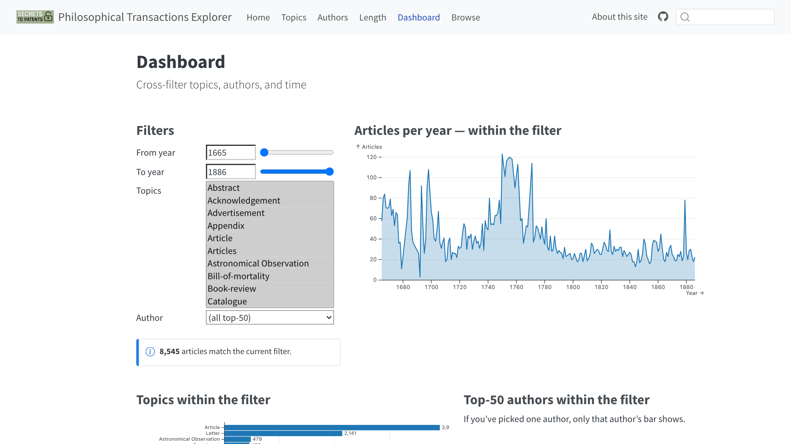
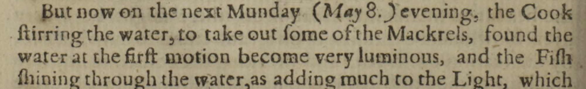
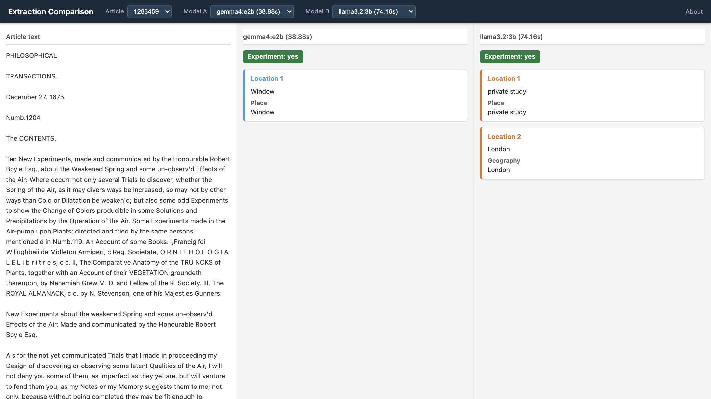
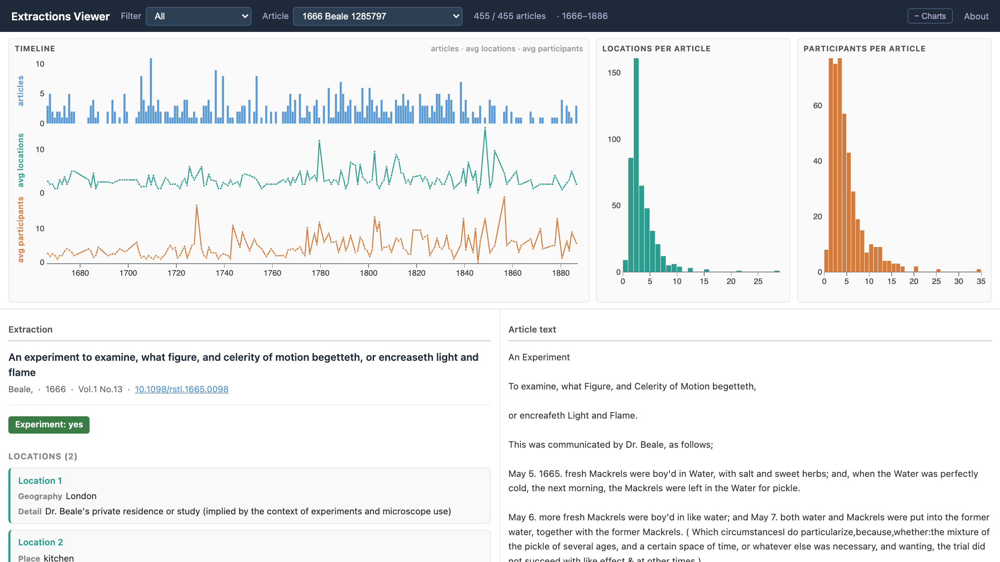
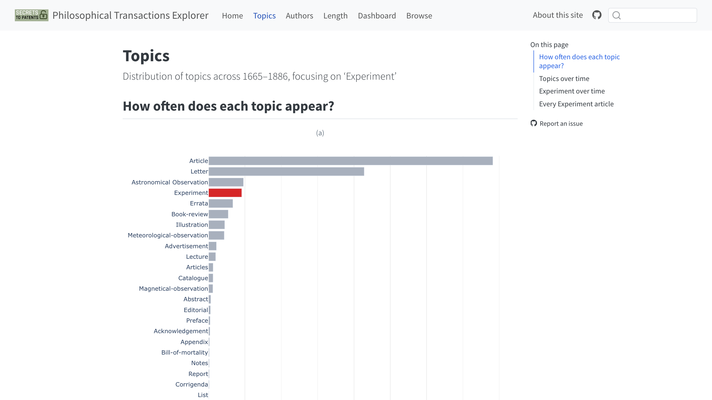

```{python}
#| label: setup
import json
from pathlib import Path

import pandas as pd
import plotly.graph_objects as go

SAGE, GREEN, INK, MUTED, HAIRLINE = "#a5b097", "#5b7f3a", "#2b3324", "#5f6856", "#dcdfd4"

articles = pd.DataFrame(json.loads(Path("data/articles.json").read_text()))
articles["decade"] = articles.year // 10 * 10
articles["is_letter"] = articles.topic.eq("Letter")
articles["no_author"] = articles.authors.map(len).eq(0)
by_decade = articles.groupby("decade").agg(
    letter_share=("is_letter", lambda s: 100 * s.mean()),
    median_pages=("n_pages", "median"),
    no_author=("no_author", lambda s: 100 * s.mean()),
)


def decade_bars(series, highlight, unit, name):
    """One-series decade bars: emphasised decades get a colour and a direct label."""
    labels = [f"{series[d]:.0f}{unit}" if d in highlight else "" for d in series.index]
    fig = go.Figure(go.Bar(
        x=series.index,
        y=series.values,
        text=labels,
        textposition="outside",
        textfont=dict(size=24, color=INK),
        cliponaxis=False,
        marker_color=[GREEN if d in highlight else SAGE for d in series.index],
        hovertemplate="%{x}s: %{y:.1f}" + unit + "<extra>" + name + "</extra>",
    ))
    fig.update_layout(
        width=1190, height=490, bargap=0.18, barcornerradius=4, showlegend=False,
        margin=dict(l=70, r=20, t=44, b=48),
        paper_bgcolor="rgba(0,0,0,0)", plot_bgcolor="rgba(0,0,0,0)",
        font=dict(family="Helvetica Neue, Helvetica, Arial, sans-serif", size=20, color=MUTED),
        hoverlabel=dict(font_size=20),
    )
    fig.update_xaxes(tickvals=list(range(1660, 1890, 40)), ticktext=[f"{d}s" for d in range(1660, 1890, 40)],
                     showgrid=False, linecolor=HAIRLINE, ticks="")
    fig.update_yaxes(gridcolor=HAIRLINE, zeroline=False, ticksuffix=unit, rangemode="tozero", nticks=5)
    fig.show(config={"displayModeBar": False})
```

## {.title-slide-custom}

{.title-logo .nostretch}

<h1 style="font-size:1.9em; line-height:1.1; text-align:left; margin-bottom:0.3em;">Secrets of Misinterpretation</h1>

<p style="font-size:1.05em; margin-bottom:1.4em;">What small local AI models extract from the <em>Philosophical Transactions</em>, and how far to trust them</p>

<p class="title-kicker">Mathias Johansson (Uppsala University)<br>with Cecilia Lundström and Hanna Johansson Flodin (Lund University)<br>Secrets to Patents · DEPTH · 13 November 2026</p>

# Background

## Why we care: Secrets to Patents

<p class="quote" style="font-size:1.1em;">Trans-Imperial Strategies for Keeping Medicines as Private Assets from 1500 to 1900</p>

- How knowledge moved between **secret** and **shared**
- So the journal raises a specific question: **where did experimental knowledge get made, and how public was that place?**

<div style="display:flex; gap:1em; align-items:flex-end; justify-content:space-between; margin-top:0.4em;">
<p class="caption-line" style="margin:0;">Principal investigator: Natacha Klein Käfer.</p>
<div class="qr-cell" style="flex:0 0 150px;"><span class="qr-url"><a href="https://secretstopatents.org/">secretstopatents.org</a></span></div>
</div>


## The journal

- *Philosophical Transactions* began in 1665. It is the longest-running scientific journal in the world.
- Not a journal as we know it: letters, observations, experiments, book reviews.
- A record of who could speak about nature, from where, and in what form.


## The material

::: {.stats}
::: {.stat}
<span class="n">8,545</span><span class="l">items in the catalogue</span>
:::
::: {.stat}
<span class="n">222</span><span class="l">years, 1665 to 1886</span>
:::
::: {.stat}
<span class="n">455</span><span class="l">labelled "Experiment" (about 5%)</span>
:::
:::

Two levels of evidence:

- **Metadata for everything:** title, year, authors, label, pages
- **Full text only for the 455 Experiment articles,** read by machine


## The Philosophical Transactions Explorer

<div style="display:flex; gap:1em; align-items:flex-end; justify-content:center;">

<div class="qr-cell" style="flex:0 0 170px;"><span class="qr-url"><a href="https://digitalhistory-lund.github.io/SecToPat-PhilTransExplorer/">digitalhistory-lund.github.io/<br>SecToPat-PhilTransExplorer</a></span></div>
</div>

<p class="caption-line">Five views: topics, authors, article length, a filtering dashboard, a searchable list of all 8,545 items. Metadata only.</p>


## The letter rises, then disappears

```{python}
decade_bars(by_decade.letter_share.round(1), {1660, 1750, 1870}, "%", "Share labelled Letter")
```

<p class="caption-line">Share of items labelled "Letter", by decade. 1660s covers 1665–69, 1880s covers 1880–86. Titles mentioning a letter show the same collapse.</p>


# Reading


## How the full text was read

<p class="flow-label">The 455 Experiment articles: small AI models, run locally</p>
<div class="flow">
<div class="step"><b>Scan to image</b>each page as a picture</div><div class="arrow">→</div>
<div class="step ai"><b>Read the page</b>vision model turns image into text</div><div class="arrow">→</div>
<div class="step"><b>Cut out the article</b>using its title</div><div class="arrow">→</div>
<div class="step ai"><b>Extract</b>was it an experiment? where? who?</div>
</div>

<p style="margin-top:1em;">8,506 pages of text. <strong>Pink steps are where errors of judgement get in.</strong></p>


## Monday evening, 8 May 1665

{.scan .nostretch}

::: {.quote .fragment}
"…the Cook stirring the water, to take out some of the Mackrels, found the water at the first motion become very luminous, and the Fish shining through the water…"
:::

<p class="caption-line">Dr Beale's report, <em>Philosophical Transactions</em>, vol. 1, p. 226. Scan: Royal Society.</p>


## Eight small models, one page

<table class="compare dense">
<thead><tr><th>Model</th><th>Size</th><th>Trial notes on this page</th></tr></thead>
<tbody>
<tr class="used"><td>qwen3.5:0.8b <strong>(the one we use)</strong></td><td>0.8B</td><td>"Celebrity" for Celerity, misses "begetteth"</td></tr>
<tr><td>qwen3.5:2b <strong>(ranked first)</strong></td><td>2B</td><td>Fish shining, Celerity, begetteth all correct</td></tr>
<tr><td>qwen3.5:4b</td><td>4B</td><td>Keeps long s as f, leaks metadata</td></tr>
<tr><td>qwen3-vl:2b</td><td>2B</td><td>"Fifth flinching" for Fish shining</td></tr>
<tr><td>qwen3-vl:4b</td><td>4B</td><td>"flaggatate" for stagnate</td></tr>
<tr><td>qwen3-vl:8b</td><td>8B</td><td>Page number 126 for 226, no paragraph breaks</td></tr>
<tr><td>gemma3:12b</td><td>12B</td><td>Drops lines, "cloud" for blow, "Sunday" for Monday</td></tr>
<tr><td>medgemma1.5</td><td>4B</td><td>Reorders paragraphs and drops text</td></tr>
</tbody>
</table>

<p class="caption-line">Size is the model's parameter count in billions. All run locally. One page, judged by hand, so this is a first look and not a benchmark.</p>


## What the machine read

<table class="compare">
<thead><tr><th>Printed on the page</th><th>The model we chose</th><th>Another model we tried</th></tr></thead>
<tbody>
<tr><td>Celerity of Motion</td><td><span class="wrong">Celebrity</span> of Motion</td><td>Celerity of Motion</td></tr>
<tr><td>the Fish shining</td><td>the Fish shining</td><td>the <span class="wrong">Fifth flinching</span></td></tr>
</tbody>
</table>

::: {.fragment}
<p style="margin-top:1.1em;">In 1665 "Fish shining" is printed with a long&nbsp;s: <em>Fiſh ſhining</em>.</p>
<p>Each error is plausible. Each reads as fluent English. <strong>That is the problem.</strong></p>
:::

<p class="caption-line">From a trial of eight small vision models on this page. The trial notes rank a larger model first. We chose a smaller, faster one for 8,506 pages.</p>


## What we asked the model

<div class="prompt">You are analysing an article from the Philosophical Transactions…<br>Answer three questions:<br><br>1. <strong>is_experiment</strong>: "yes", "no", or "unsure"<br>2. <strong>locations</strong>: place, geography, detail<br>3. <strong>participants</strong>: name, role</div>

<p style="margin-top:0.9em;">The answer must fit a fixed form, so every article becomes a row of data.</p>


## Model selection: read them side by side

<div style="display:flex; gap:1em; align-items:flex-end; justify-content:center;">

<div class="qr-cell" style="flex:0 0 170px;"><span class="qr-url"><a href="https://digitalhistory-lund.github.io/SecToPat-PhilTransModelSelection/">digitalhistory-lund.github.io/<br>SecToPat-PhilTransModelSelection</a></span></div>
</div>

<p class="caption-line">Six local models, four articles, the text beside any two outputs.</p>

## One article, six answers

<p class="small muted" style="margin-bottom:0.2em;">Hauksbee, "An Experiment on the descent of Malt dust in the Evacuated Receiver, at Grefham College". About 180 words.</p>

<table class="compare dense">
<thead><tr><th>Model</th><th>Locations returned</th></tr></thead>
<tbody>
<tr><td>gemma4:e2b</td><td class="extracted">Receiver · Grefham College · <span class="wrong">St Paul's Church-yard</span></td></tr>
<tr><td>llama3.2:3b</td><td class="extracted">Grefham College · London</td></tr>
<tr class="used"><td>ministral-3:3b <strong>(small version of ours)</strong></td><td class="extracted"><span class="wrong">Evacuated Receiver</span> · <span class="wrong">Receiver</span></td></tr>
<tr><td>phi3.5</td><td class="extracted"><span class="wrong">private study or laboratory setting</span> within Grefham College · two more</td></tr>
<tr><td>qwen3.5:2b</td><td class="extracted">Grefham College</td></tr>
<tr><td>qwen3.5:4b</td><td class="extracted">Grefham College</td></tr>
</tbody>
</table>

<p class="caption-line">"Grefham" is the long s again. St Paul's Church-yard is the printer's address at the foot of the page. llama, phi and qwen used an earlier two-question prompt.</p>

## Choosing without an answer key

- A **quick manual comparison**: six models, four articles, read side by side
- **No answer key**, so no accuracy score
- Prompts differed between models
- We compared the 3.8B ministral-3. The pipeline code names the **8.9B** one

## What came out

::: {.stats}
::: {.stat}
<span class="n">455</span><span class="l">articles read</span>
:::
::: {.stat}
<span class="n">1,409</span><span class="l">locations</span>
:::
::: {.stat}
<span class="n">2,032</span><span class="l">participants</span>
:::
:::

- Most frequent place: **London** (63, and 38 more as "London, England")
- Most frequent people: **Michael Faraday** 24, **Mr. Fr. Hauksbee** 16, **Robert Boyle** 14
- Not yet tidied: 1,646 different name forms. "Dr. Priestley" and "Joseph Priestley" count apart

## The Extractions Viewer

<div style="display:flex; gap:1em; align-items:flex-end; justify-content:center;">

<div class="qr-cell" style="flex:0 0 170px;"><span class="qr-url"><a href="https://digitalhistory-lund.github.io/SecToPat-PhilTransExtractions/">digitalhistory-lund.github.io/<br>SecToPat-PhilTransExtractions</a></span></div>
</div>

<p class="caption-line">All 455 articles, each extraction beside its text. Filter by year and result, share a link to any view.</p>

## What a small team can now do

- Models small enough to run **on our own machine**, with no sources sent elsewhere, at **about 17 seconds a page**
- A site and pipeline built by **one person with a coding assistant** (Claude, credited)
- Openly citable: **all three sites have DOIs**

::: {.fragment}
<p style="margin-top:0.8em;"><strong>Building it got cheap. Checking it did not.</strong></p>
:::

# Failing Forward

## Back to the mackerel

<table class="compare">
<thead><tr><th>What the model extracted</th><th>In the article?</th></tr></thead>
<tbody>
<tr><td class="extracted">London</td><td><span class="wrong">Never mentioned</span></td></tr>
<tr><td class="extracted">"Dr. Beale's private residence or study (implied by the context of experiments and microscope use)"</td><td><span class="wrong">"private" and "study" never appear.</span> The microscope does</td></tr>
<tr><td class="extracted">kitchen</td><td>Never mentioned. A Cook, and "the house", are</td></tr>
</tbody>
</table>

<p class="caption-line">Checked against the machine-read text of the article, 848 words.</p>

## Models also ignore what they are told

<p class="small muted">We told the model: <em>"Do not include apparatus or containers as locations."</em></p>

<table class="compare">
<thead><tr><th>Extracted place</th><th>Detail, as extracted</th></tr></thead>
<tbody>
<tr><td class="extracted">exhausted receiver (same as above)</td><td class="extracted">where the sparrow was placed</td></tr>
<tr><td class="extracted">exhausted receiver (same as above)</td><td class="extracted">floor area where the cat was placed</td></tr>
</tbody>
</table>

<p style="margin-top:0.9em;">And on "is this an experiment?", 448 of 455 said yes.<br><span class="muted">All 455 were already labelled Experiment, so that is agreement, not accuracy.</span></p>

## We gave the model an example

<div class="prompt">place: the immediate setting at room or building scale<br>(e.g. <mark>"private study"</mark>, "ship's cabin", "kitchen");<br>null if not mentioned</div>

::: {.fragment}
<p style="margin-top:1em;">The single most common answer across all 455 articles:</p>
<p class="quote" style="font-size:1.2em;">"private study or laboratory"</p>
<p class="muted small">26 exact matches. "kitchen" appears 4 times.</p>
:::

::: {.fragment}
<p class="small" style="margin-top:0.6em;">On a Franklin paper, llama3.2 returned <strong>"private study"</strong> and <strong>"kitchen"</strong>. Neither word is in the article.</p>
:::

## "Private" 144 times. "Public" never.

::: {.stats}
::: {.stat .alert}
<span class="n">144</span><span class="l">of 965 extracted places contain "private"</span>
:::
::: {.stat}
<span class="n">0</span><span class="l">contain "public"</span>
:::
:::

<ul class="extracted">
<li>"private study or meeting room (Royal Society)"</li>
<li>"private study or laboratory (Royal Institution)"</li>
<li>"private laboratory or workshop (attached to Gresham College)"</li>
</ul>

## What this leaves us with

**Machines are good for** seeing the shape of a whole archive, finding where to look, and asking new questions of it.

**A human reader is still needed** to decide what a word like *private* means, and to measure how wrong the machine is.

::: {.fragment}
<p class="quote" style="margin-top:0.9em;">Our categories can shape what the model finds. Check them before you count them.</p>
:::

## Thank you

<div style="display:flex; gap:1.2em; align-items:center; margin:0 0 0.6em;">
{.nostretch style="width:150px; margin:0;"}
<p class="small" style="margin:0;">Natacha Klein Käfer, principal investigator<br>Mathias Johansson, Cecilia Lundström and Hanna Johansson Flodin, authors<br>Contact: <a href="mailto:Mathias.Johansson@fek.uu.se">Mathias.Johansson@fek.uu.se</a></p>
</div>

<div class="qr-row">
<div class="qr-cell"><span class="qr-label">These slides</span><span class="qr-url"><a href="https://digitalhistory-lund.github.io/2026-11-13_DEPTH-philtransexplorer/">digitalhistory-lund.github.io/<br>2026-11-13_DEPTH-philtransexplorer</a></span></div>
<div class="qr-cell"><span class="qr-label">Extractions Viewer</span><span class="qr-url"><a href="https://digitalhistory-lund.github.io/SecToPat-PhilTransExtractions/">SecToPat-PhilTransExtractions</a><br><a href="https://doi.org/10.5281/zenodo.20502387">doi 20502387</a></span></div>
<div class="qr-cell"><span class="qr-label">Model selection</span><span class="qr-url"><a href="https://digitalhistory-lund.github.io/SecToPat-PhilTransModelSelection/">SecToPat-PhilTransModelSelection</a><br><a href="https://doi.org/10.5281/zenodo.20502415">doi 20502415</a></span></div>
<div class="qr-cell"><span class="qr-label">Explorer</span><span class="qr-url"><a href="https://digitalhistory-lund.github.io/SecToPat-PhilTransExplorer/">SecToPat-PhilTransExplorer</a><br><a href="https://doi.org/10.5281/zenodo.20162091">doi 20162091</a></span></div>
<div class="qr-cell"><span class="qr-label">Mathias on LinkedIn</span><span class="qr-url"><a href="https://www.linkedin.com/in/mathiasjoha/">linkedin.com/in/mathiasjoha</a></span></div>
</div>

<p class="caption-line">Sites at digitalhistory-lund.github.io</p>

# Encore

## Backup: The typical article grows from 3 pages to over 20

```{python}
decade_bars(by_decade.median_pages, {1660, 1870, 1880}, "", "Median pages")
```

<p class="caption-line">Median pages per item, by decade, for the 8,081 items with usable page numbers. 1880s covers 1880–86.</p>

## Backup: Fewer and fewer items without a named author

```{python}
decade_bars(by_decade.no_author.round(1), {1660, 1870}, "%", "No author listed")
```

<p class="caption-line">Share of items with no author listed in the publisher's metadata, by decade. 1660s covers 1665–69.</p>

## Backup: See for yourself

<div style="display:flex; gap:1em; align-items:flex-end; justify-content:center;">

<div class="qr-cell" style="flex:0 0 170px;"><span class="qr-url"><a href="https://digitalhistory-lund.github.io/SecToPat-PhilTransExplorer/">digitalhistory-lund.github.io/<br>SecToPat-PhilTransExplorer</a></span></div>
</div>

## Backup: How the catalogue was made

<p class="flow-label">Every item: no AI involved</p>
<div class="flow">
<div class="step"><b>Crawl</b>publisher's public pages, decade by decade</div><div class="arrow">→</div>
<div class="step"><b>Index</b>one database of articles and authors</div><div class="arrow">→</div>
<div class="step"><b>Aggregate</b>counts checked to reconcile</div><div class="arrow">→</div>
<div class="step"><b>Publish</b>a static website</div>
</div>

<p style="margin-top:1em;">8,545 records and 8,545 PDFs. The script stops if the totals don't add up.</p>

## Backup: Even plain metadata misleads

<table class="compare">
<thead><tr><th>What you see</th><th>What is going on</th></tr></thead>
<tbody>
<tr><td>Hooke, Robert · Hook, · Hooke, · Hooke's, Dr.</td><td>One person, four "authors"</td></tr>
<tr><td>Maskelyne publishes from 1759 to 1879</td><td>Almost certainly two people with one surname</td></tr>
<tr><td>"Article" and "Articles" as separate topics</td><td>Labels from the publisher's web pages. Their origin is unknown</td></tr>
<tr><td>A 1,005-page reply from Newton</td><td>A typing error in the page numbers</td></tr>
</tbody>
</table>


